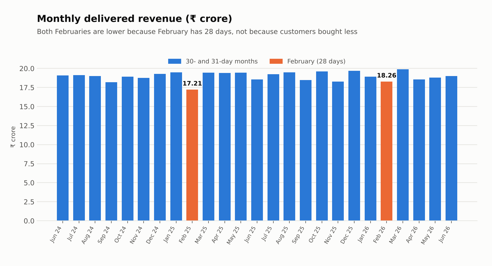
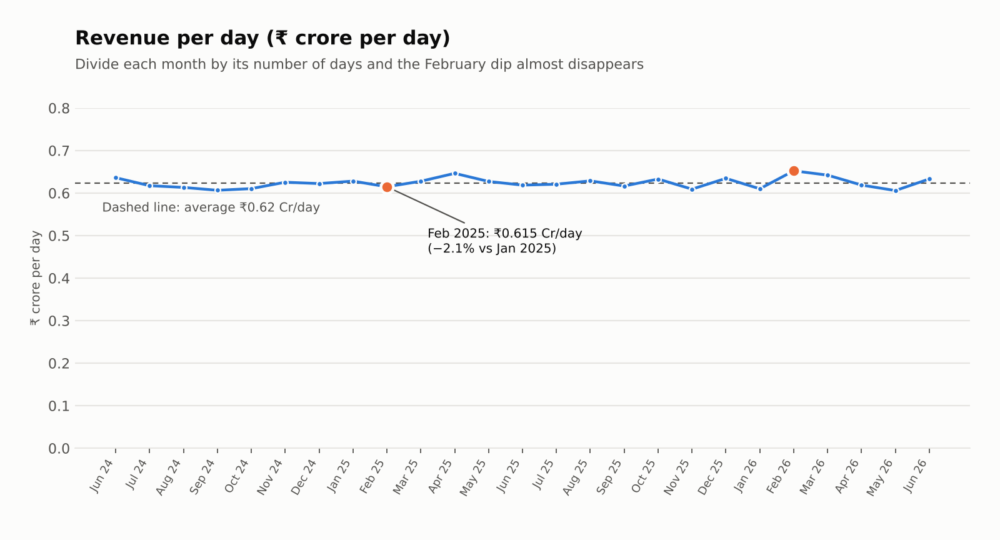

# E-commerce Sales Analysis: Business Report

**Period:** 1 June 2024 to 30 June 2026 (25 months)
**Data:** 40,000 customers, 2,000 products, 250,000 orders
**Tools:** Python (pandas) for cleaning, PostgreSQL for analysis queries, Power BI for the dashboard
**Author:** Titli

> **About the data:** this is a synthetic dataset. Many patterns are evenly spread (gender, cities, weekdays, ratings), so the report focuses on structure that is actually visible and says plainly where nothing stands out. Findings describe this dataset, not a real market.

---

## 1. Executive summary

Over 25 months, delivered orders brought in **₹474.16 crore** from **200,139 orders**, with an average order value of **₹23,691**. 39,726 of the 40,000 customers placed at least one delivered order.

| Metric | Value |
|---|---|
| Revenue (delivered orders) | ₹474.16 Cr |
| Delivered orders | 200,139 |
| Average order value | ₹23,691 |
| Average monthly revenue | ₹18.97 Cr (range ₹17.21 Cr to ₹19.91 Cr) |
| Customers with at least one delivered order | 39,726 of 40,000 |

**Five takeaways**

1. **Electronics is the business.** It brings 72.6% of revenue from only 26.8% of orders.
2. **Revenue is flat, not growing.** January to June 2025 earned ₹113.54 Cr and January to June 2026 earned ₹113.42 Cr.
3. **The February 2025 drop is a calendar effect.** February has 28 days. Revenue per day fell only 2.1% (Section 4).
4. **Customers are loyal but split by age.** 96.7% of buyers ordered more than once, but each age group buys only three of the seven categories, and customers aged 46 and over never buy Electronics.
5. **About 20% of orders did not complete cleanly.** 5% were cancelled and 5% returned (₹60.3 Cr of order value), and another 9.9% (24,861 orders, ₹58.7 Cr) are still marked Processing or Shipped long after their expected delivery date.

---

## 2. Data, definitions and method

**Tables:** `customer` (one row per customer), `product` (one row per product), `sale` (one row per order, linked by `customer_id` and `product_id`). All joins matched with no orphan rows.

**Definitions**

| Term | Meaning |
|---|---|
| Revenue | `total_amount` of orders with status **Delivered** (order value + shipping − coupon). Cancelled, returned, shipped and processing orders are excluded. |
| Average order value | Revenue divided by delivered orders |
| 1 crore (Cr) | 10 million rupees |
| Buyer | A customer with at least one delivered order |

**Cleaning done in pandas**

| Issue | Fix |
|---|---|
| Hidden BOM character in the first column name | Read files with `utf-8-sig` |
| Phone numbers stored as negative numbers | Converted to positive text |
| State "UP" next to full state names | Replaced with "Uttar Pradesh" |
| Dates stored as text | Parsed as real dates |
| 5 orders with a negative total (coupon larger than the order) | Total set to 0 |
| Missing coupon codes | Filled with "No Coupon" |
| Delivery dates on cancelled, processing and shipped orders | Cleared for cancelled orders; kept as "expected delivery date" for processing and shipped |
| Customer columns copied into sales | Dropped and rejoined from the clean customer table |
| Pincodes that do not match cities | Not used in any analysis |

**Process:** pandas (clean) → PostgreSQL (`e_commerce` database, analysis queries) → Power BI (2-page dashboard). Results were cross-checked between tools: revenue by category in SQL and the dashboard totals in Power BI match the pandas figures.

---

## 3. Findings

### 3.1 Revenue by category

| Category | Revenue (₹ Cr) | Share of revenue | Share of orders | Average order (₹) |
|---|---:|---:|---:|---:|
| Electronics | 344.33 | 72.6% | 26.8% | 64,269 |
| Home | 57.33 | 12.1% | 13.4% | 21,330 |
| Sports | 37.94 | 8.0% | 11.7% | 16,206 |
| Fashion | 26.66 | 5.6% | 19.9% | 6,691 |
| Grocery | 3.35 | 0.7% | 13.4% | 1,249 |
| Beauty | 3.07 | 0.6% | 6.7% | 2,283 |
| Books | 1.49 | 0.3% | 8.1% | 918 |

Price, not volume, drives revenue. Fashion is the second most ordered category (19.9% of orders) but only 5.6% of revenue. The five top brands by revenue are all Electronics brands: HP, Noise, boAt, Samsung and Apple.

### 3.2 Geography

Uttar Pradesh (₹61.87 Cr), Rajasthan (₹60.47 Cr) and Haryana (₹59.77 Cr) lead. Karnataka (₹36.04 Cr) and West Bengal (₹36.47 Cr) are lowest. State totals partly reflect how many cities each state has in the data (five for the top three, three for Karnataka and West Bengal). City totals are close together (₹10.8 Cr to ₹13.6 Cr), so no single city dominates.

### 3.3 Trend

Monthly revenue stays between ₹17.21 Cr and ₹19.91 Cr with no growth over the 25 months. Most of the month-to-month movement comes from month length (Section 4).

### 3.4 Customers

| Age group | Share of revenue | Average order (₹) | Categories bought |
|---|---:|---:|---|
| 18 to 25 | 25.1% | 24,144 | Books, Electronics, Fashion |
| 26 to 35 | 43.3% | 29,182 | Electronics, Fashion, Sports |
| 36 to 45 | 24.6% | 29,010 | Electronics, Grocery, Home |
| 46 to 55 | 4.3% | 8,275 | Beauty, Grocery, Home |
| 56 to 65 | 2.2% | 8,406 | Beauty, Grocery, Home |
| 65 and over | 0.7% | 8,053 | Beauty, Grocery, Home |

- **Repeat buying:** 96.7% of buyers ordered more than once, with an average of 5.0 delivered orders. 1,320 buyers ordered only once.
- **Spread of value:** the top 10% of customers bring 29.8% of revenue and the top 20% bring 48.7%, so revenue is not heavily concentrated in a few customers.
- **Inactive buyers:** 12,009 buyers (30.2%) had no delivered order in the 180 days before 30 June 2026.
- **No orders:** 274 customers never had a delivered order (86 of them never placed any order).
- **Segments:** using quartiles of lifetime spend, High is ₹170,000 and above (9,999 customers), Medium is ₹38,000 to ₹170,000 (19,952) and Low is under ₹38,000 (10,049). Fixed cut-offs of ₹50,000 and ₹10,000 put 68% of customers in "High", which makes the label meaningless.

### 3.5 Order outcomes

| Status | Orders | Share | Order value (₹ Cr) |
|---|---:|---:|---:|
| Delivered | 200,139 | 80.1% | 474.16 |
| Cancelled | 12,507 | 5.0% | 30.21 |
| Returned | 12,493 | 5.0% | 30.04 |
| Shipped | 12,459 | 5.0% | 29.11 |
| Processing | 12,402 | 5.0% | 29.55 |

Cancel and return rates are almost identical in every category (4.9% to 5.1%) and every payment mode, so the cause is unlikely to be a particular product or payment method. Of the 24,861 orders still Processing or Shipped, 24,724 are past their expected delivery date and 7,071 were placed in 2024.

### 3.6 Coupons, discounts and payment

- 20.1% of delivered orders used a coupon. Total coupon discounts were **₹5.01 Cr, or 1.04% of order value**.
- Coupon orders are 2.6% larger before the discount (₹24,435 vs ₹23,811) and 2.6% smaller after it (₹23,194 vs ₹23,816).
- A higher product discount percentage does not sell more: the average units per order is 1.25 in every discount band (0 to 15%, 15 to 25%, 25 to 35%, 35 to 50%).
- Payment mix of delivered orders: UPI 51.4%, cash on delivery 32.8%, debit card 11.6%, credit card 4.2%.

### 3.7 Where nothing stands out

Weekday revenue (₹66.4 Cr to ₹68.9 Cr), order hour, gender (50/50), average rating (4.40) and delivery time (4.5 days) are essentially flat across the dataset. They are not reported as insights.

---

## 4. Why did February revenue drop?

**Question:** Revenue fell from ₹19.47 Cr in January 2025 to ₹17.21 Cr in February 2025, a drop of 11.6%. Did something go wrong?

**Answer:** No. February has 28 days and January has 31. Per day, the business performed almost the same.

### Evidence

Revenue is the product of three things: the number of days, orders per day, and average order value.

| Measure (delivered orders) | January 2025 | February 2025 | Change |
|---|---:|---:|---:|
| Revenue | ₹19.47 Cr | ₹17.21 Cr | **−11.6%** |
| Orders | 8,216 | 7,378 | −10.2% |
| Days in month | 31 | 28 | **−9.7%** |
| Orders per day | 265.0 | 263.5 | −0.6% |
| Average order value | ₹23,699 | ₹23,330 | −1.6% |
| **Revenue per day** | ₹0.628 Cr | ₹0.615 Cr | **−2.1%** |

Multiplying the three changes gives (1 − 0.097) × (1 − 0.006) × (1 − 0.016) = 0.884, which is the −11.6% drop. **Fewer days alone account for about 9.7 of the 11.6 points.**

### Monthly Delivered Revenue

### Revenue Per Day

### Other explanations checked and ruled out

- **Category mix:** no category collapsed. Electronics was 72.1% of revenue in January and 72.3% in February. The largest shift was Sports, down 0.7 percentage points (8.5% to 7.8%).
- **Cancellations and returns:** the share of orders delivered was the same (80.2% vs 80.1%). All orders placed, in any status, fell 10.1% (10,243 to 9,211), matching the delivered drop, so conversion did not change.
- **Order size:** average order value moved only 1.6%.

### It repeats every year

- **February 2026:** revenue fell 3.4% against January 2026 (₹18.91 Cr to ₹18.27 Cr), yet revenue per day **rose** 6.9% (₹0.610 Cr to ₹0.652 Cr). The total still fell because of the 28 days.
- **Other short months:** 30-day months average ₹18.70 Cr and 31-day months average ₹19.31 Cr, a gap of 3.2%, which is exactly the 30/31 day ratio.
- **Smoother series:** adjusting for month length lowers the month-to-month variation of revenue from 3.1% to 2.0%.
- **Rebound:** March 2025 revenue was 13.1% above February.

### Conclusion

If February 2025 had 31 days at its own daily rate, revenue would have been ₹19.06 Cr, only 2.1% below January. That remaining gap is about one standard deviation of normal monthly variation (2.0%), so it is not a meaningful decline. **The February drop is a calendar effect, not a business problem, and needs no corrective action.**

**Reporting recommendation:** track revenue per day, or compare each month with the same month a year earlier, so short months do not trigger false alarms.

---

## 5. Recommendations

These come from the patterns above. Because the data is synthetic, treat them as hypotheses to test, not conclusions.

1. **Report revenue per day** (or same-month year-over-year) in dashboards, so February and 30-day months do not look like declines.
2. **Watch Electronics concentration.** A 10% fall in Electronics revenue alone would cut total revenue by about 7%.
3. **Investigate the order backlog.** 24,861 orders (₹58.7 Cr) are still Processing or Shipped, including 7,071 placed in 2024. Either status updates are not being recorded or fulfilment is stuck.
4. **Find why 10% of orders are cancelled or returned.** The rates are uniform across categories and payment modes, which points to a process-wide cause. Capture a reason code for each cancellation and return.
5. **Re-engage the 12,009 inactive buyers** (no delivered order in 180 days). Customers aged 26 to 45 bring 67.9% of revenue, so start there.
6. **Test Electronics offers for customers aged 46 and over.** They buy only Beauty, Grocery and Home, with an average order of about ₹8,300 compared with ₹24,000 to ₹29,000 for younger customers.
7. **Review the coupon spend.** ₹5.01 Cr of discounts produced no visible change in units per order. Run a controlled test before renewing the same coupons.

---

## 6. Limitations

- **Synthetic data.** Distributions are artificially even, so the results do not describe real customer behavior.
- **Revenue, not profit.** There is no cost or margin data.
- **Partial years.** 2024 covers June to December and 2026 covers January to June, so full-year totals are not comparable.
- **Customer age is a snapshot** from the customer table, not the age on the order date.
- **Returned orders are excluded from revenue.** The data does not say when the return happened.
- **Product names repeat** across product IDs (350 names for 2,000 products), so product-level work uses `product_id`.
- **Pincodes do not match cities** and were not used.

---

## 7. Appendix

**Files**

| File | Contents |
|---|---|
| `cleaned_data.ipynb` | pandas cleaning, joins, checks and exploratory analysis |
| `e_com.sql` | PostgreSQL analysis queries (basic to business-case level) |
| `e_com.pbix` | Power BI dashboard |
| `monthly_summary.csv` | The monthly figures behind the charts in Section 4 |
| `images/` | Charts used in this report |

**How to reproduce:** run the notebook to clean the data and write the `*_clean.csv` files, load them into PostgreSQL with `to_sql`, run the queries in `e_com.sql`, then connect Power BI to the `e_commerce` database.
